# Wavesmith

**Local-first AI music studio** — describe a song, get full tracks with vocals, build a library, pull stems. Inspired by Suno-style workflows, but everything runs on your machine: no accounts, no cloud API, no telemetry.

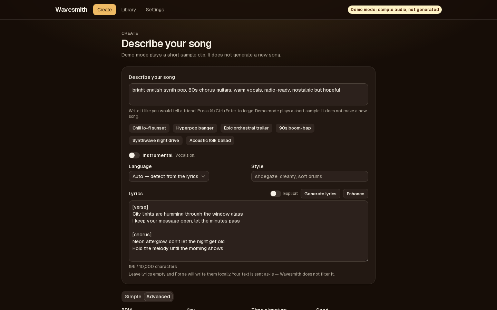

Screenshots in this README are from demo mode. Playback is the bundled sample clip, not a generated track.

| | |
|---|---|
| **Verified platform** | macOS on Apple Silicon (M-series, 32 GB RAM tested) |
| **License** | GNU GPL v3.0 ([LICENSE](LICENSE)) |
| **Music engine** | [ACE-Step 1.5](https://github.com/ace-step/ACE-Step-1.5) (separate upstream project, MIT), pinned v0.1.8 |
| **Linux / NVIDIA** | [Documented only](docs/LINUX_CUDA.md) — not tested in this repo |

---

## What you get

- **Create** — a single “describe your song” composer: prompt, lyrics, language, style, instrumental toggle, 6 presets, Simple/Advanced controls, 1–4 variations; **multilingual lyrics** (50+ engine languages, auto prompt/lyrics splitting)
- **Edit** — open a song and regenerate one section, or extend past the end. The original take stays in the library
- **Library** — grid/list, procedural cover art, favorites, search, playback, export/import (JSON metadata)
- **Playback** — one global player + waveform; seeking works (HTTP Range support)
- **Stems** — Demucs separation → vocals / drums / bass / other + ZIP download
- **MIDI** — approximate audio→MIDI transcription (Basic Pitch) from full mix or individual stems
- **Settings** — engine health, storage stats, light/dark theme, local-only or optional Grok hybrid, unrestricted lyrics, optional test generation

Optional **Generate Lyrics** uses a local [Ollama](https://ollama.com) model. If Ollama is not installed, that button hides and everything else still works.

---

## Screenshots

**Library.** Takes in a grid, dark and light.

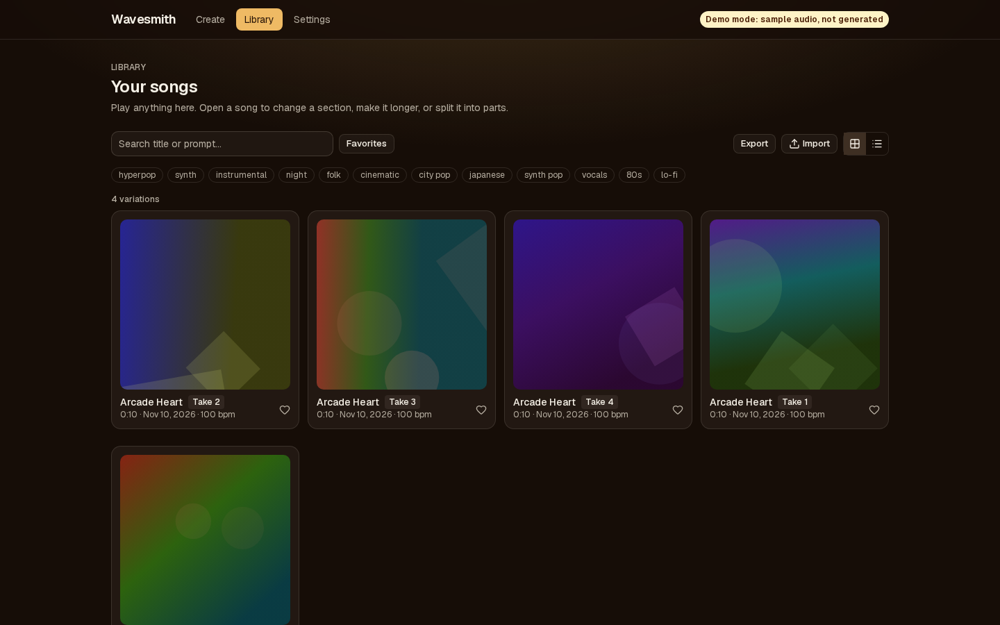

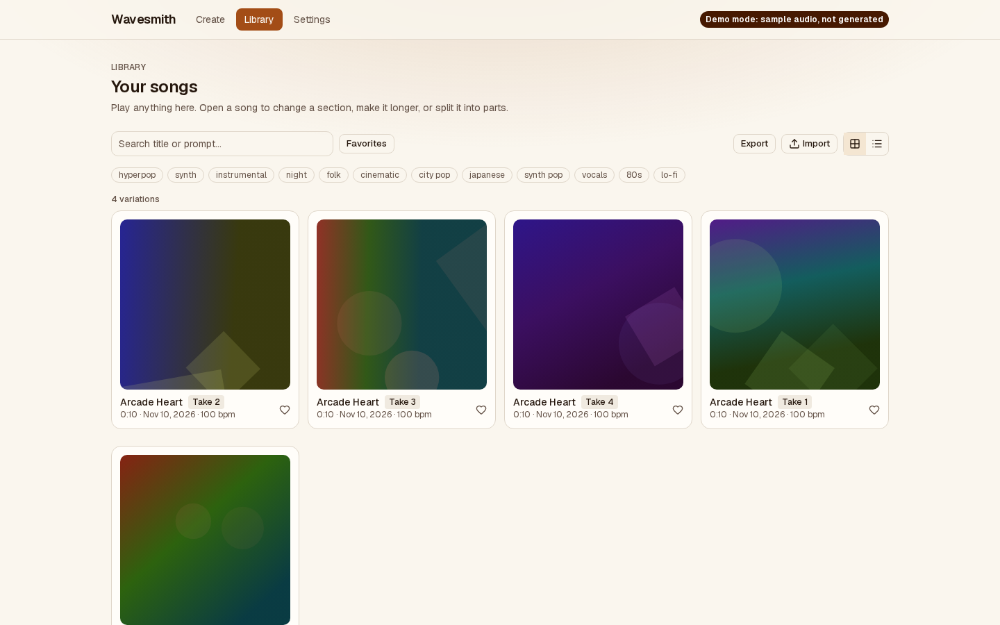

**Song.** Waveform, cover, and the player.

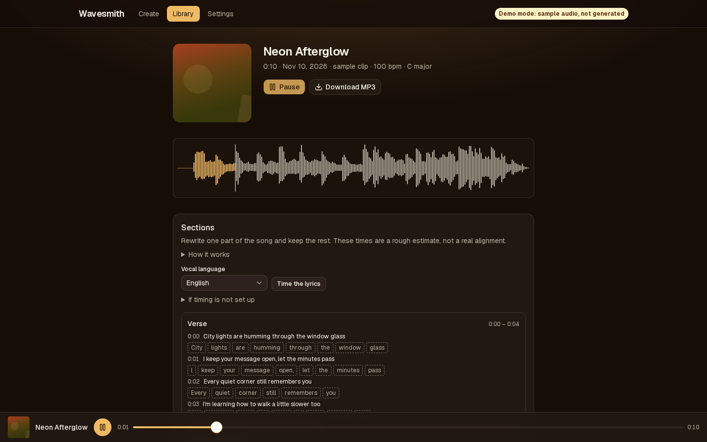

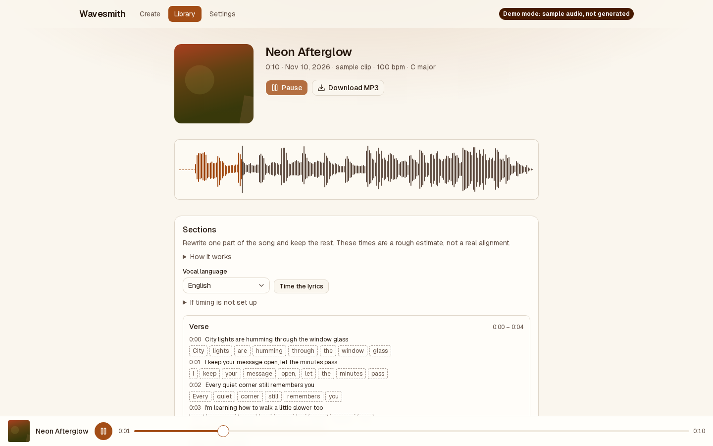

**Sections.** A verse timeline with estimated word chips.

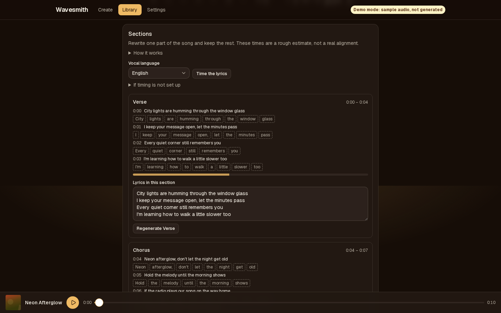

**Make it longer.** Add 15 or 30 seconds onto the end.

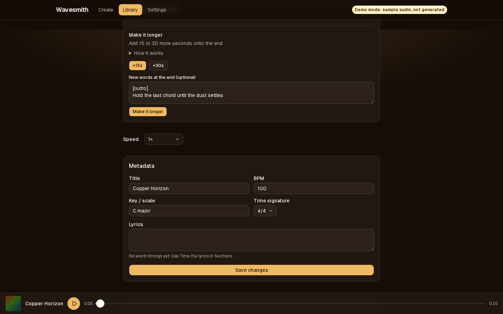

**Parts and a notes file.** Vocals, drums, bass, other, and a downloadable notes file.

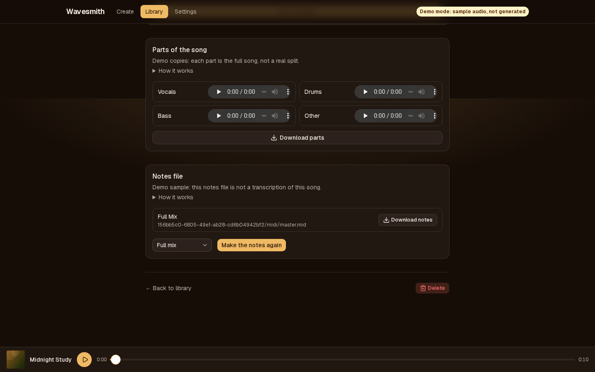

**Settings.** Engine status, with Grok hybrid selected and no key stored.

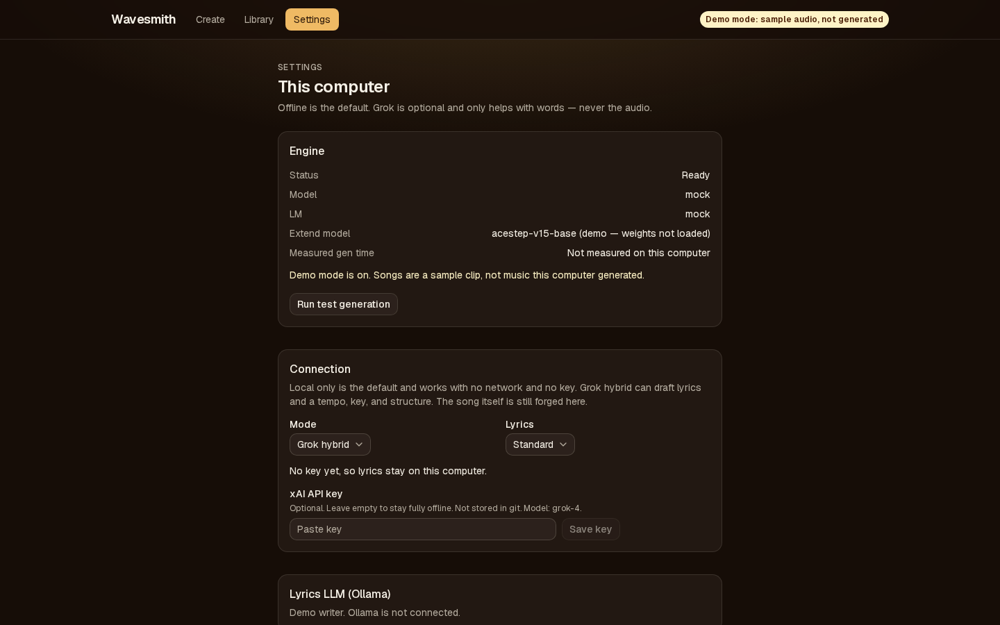

**Narrow screens** (390 px wide). These show the layout in a small window, not a paired phone. Pairing is in **Use it from your phone** below.

<table>
  <tr>
    <td>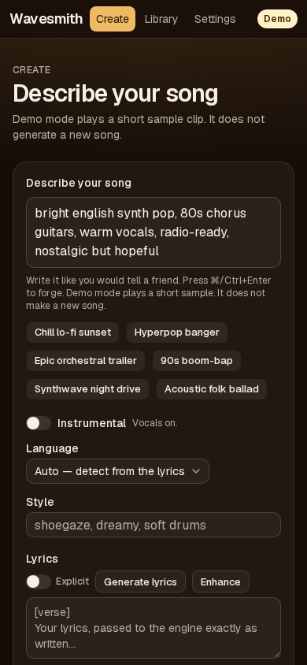</td>
    <td>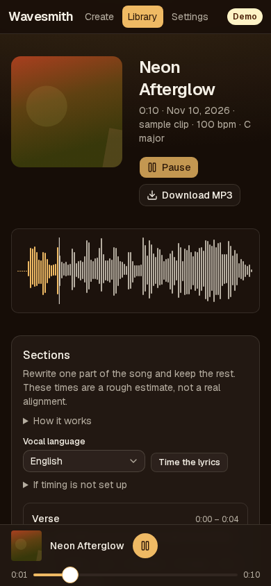</td>
  </tr>
  <tr>
    <td>Create</td>
    <td>Song</td>
  </tr>
</table>

---

## Requirements

### Hardware (recommended)

- **Apple Silicon Mac** (M1/M2/M3 class)
- **32 GB RAM** — engine weights (~10 GB on disk) plus runtime memory; 16 GB may work but is tight if you also run a large lyrics model concurrently
- **~25 GB free disk** after clone:
  - ~10 GB model weights (one-time download)
  - ~1.2 GB Python venv (engine)
  - ~1 GB Node dependencies
  - Generated audio grows under `./data/`

### Software (setup installs or checks these)

| Tool | Purpose |
|------|---------|
| [Homebrew](https://brew.sh) | Package manager on macOS |
| **Node.js** 22+ (26 verified) | Next.js app |
| **pnpm** | Node dependencies |
| **uv** | Python tooling for engine + Demucs |
| **ffmpeg** | MP3 encoding, media tooling |
| **Python 3.12** | Used by uv for Demucs install |
| **git** | Clone engine + this repo |

---

## What's in the repo vs what setup downloads

**Included in git:**

- Wavesmith app (Next.js 16, React 19, SQLite library)
- Scripts, tests, docs, `public/demo-clip.mp3` (mock/demo audio)
- `.env.example` — copy to `.env` on first setup

**Not in git** (created by `scripts/setup.sh` on your machine):

| Path | Size (approx.) | What it is |
|------|----------------|------------|
| `engine/ACE-Step-1.5/` | ~1.2 GB venv + ~10 GB weights | Pinned ACE-Step clone + models |
| `data/` | grows with use | SQLite DB + generated WAV/MP3/stems |
| `node_modules/` | ~hundreds of MB | App dependencies |
| `.env` | tiny | Your local config (never commit) |

---

## Quickstart

One line installs Homebrew if you need it, then Node 22 or newer, pnpm, uv, ffmpeg, Python 3.12, and git. It clones Wavesmith to `~/Wavesmith`, downloads the music models, and adds the `wavesmith` command.

The address is a commit, not the moving `main` branch. When `scripts/install.sh` changes, commit that change, then point this line at that commit in a follow-up that only updates the pin. The Homebrew installer inside the script has its own pinned commit; the note at the top of `scripts/install.sh` says how to bump that one.

```bash
curl -fsSL --proto '=https' --tlsv1.2 https://raw.githubusercontent.com/siriusbontea/wave-smith/b340e51de2eb3166fd520daeedcbb6e113179782/scripts/install.sh | bash
wavesmith start
```

`wavesmith start` builds the app if it has not been built, starts the music engine and the page, and opens **http://127.0.0.1:3000** when the page answers. Nothing listens on the whole network. The first run takes a while because the models are about 10 GB. The browser shows that progress, with a percent and a time estimate once the download has a speed.

Then:

1. Type a prompt, or pick a preset.
2. Click **Forge**.
3. Open **Library** and play the song.

| Command | What it does |
|---------|----------------|
| `wavesmith start` | Start the engine and the app, then open the browser |
| `wavesmith stop` | Stop them |
| `wavesmith status` | Say whether they are running |
| `wavesmith open` | Open http://127.0.0.1:3000 |
| `wavesmith update` | Stop the app if it is running, update, then start it again. Songs and `.env` stay |
| `wavesmith doctor` | Check this Mac and print a fix for each problem |
| `wavesmith logs` | Show the recent log |
| `wavesmith uninstall` | Remove the app. It asks before deleting songs or models |

The installer is safe to run again. It says what it is doing at each step.

### Menu bar

The installer also puts **Wavesmith.app** in `~/Applications`. Double-click it. A music-note icon appears in the menu bar: **Start**, **Stop**, **Open Wavesmith**, **Status**, **Launch at Login**, and **Quit**. Quit closes the icon. It does not stop the music. Launch at Login is off until you turn it on. Turning it on starts Wavesmith immediately, and again each time you log in. It uses a login item for your user only, and that item does not contain passwords or API keys.

The app is not signed. The first time, macOS may say it cannot be opened. **Right-click Wavesmith in Applications, choose Open, then Open.** You do that once.

### If you are developing

```bash
git clone https://github.com/siriusbontea/wave-smith.git ~/Wavesmith
cd ~/Wavesmith
./scripts/setup.sh
./scripts/dev.sh
```

`./scripts/dev.sh` is the hot-reload server. `wavesmith start` is the production server. Both bind **127.0.0.1** only.

| Process | URL |
|---------|-----|
| Wavesmith | **http://127.0.0.1:3000** |
| ACE-Step engine | http://127.0.0.1:8001 |

The page is on port **3000**. Port 8001 is the engine, not the page. The first warm-up after boot is about **45 seconds** once the models are on disk.

### Use it from your phone

The computer still makes the music. Tailscale is how a phone opens Wavesmith. It is off until you turn it on.

1. Install Tailscale on the Mac and on the iPhone, and sign in to the same account.
2. On the Mac, open **Settings** and choose **Turn on** under **Use from a phone**.
3. On the iPhone, scan the code, then tap **Pair**.
4. In Safari: Share → **Add to Home Screen**.
5. **Turn off** closes the door and forgets every paired phone. **Remove** forgets one phone and leaves the door open.

The code lasts 10 minutes. The header shows **Phone on** only while the door is actually open. If Tailscale is not signed in, Settings says so and nothing listens. If the phone sleeps, the queue keeps going on the computer.

Home Wi-Fi is an extra switch in Settings. It is plain HTTP, and it does not come back after a restart. Open the address Settings shows. Do not use Tailscale Serve or Funnel, and do not forward the page. Steps and the exact rules are in [docs/PHONE.md](docs/PHONE.md).

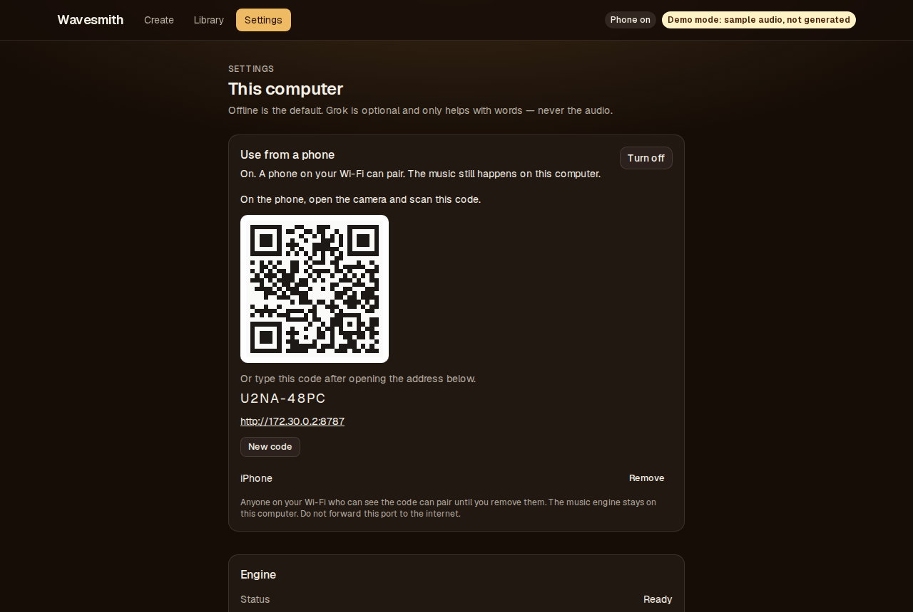

<table>
  <tr>
    <td>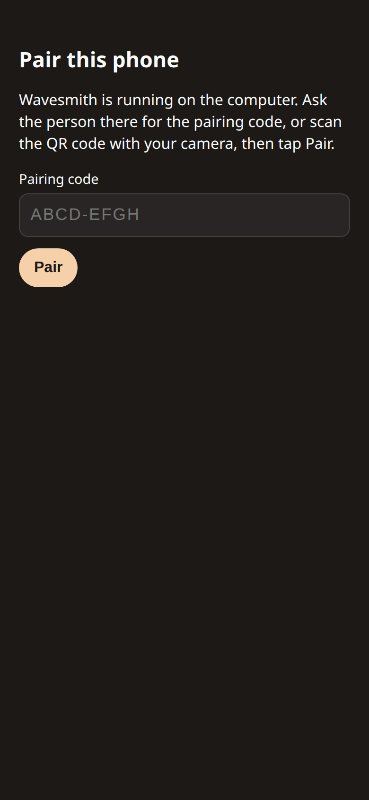</td>
    <td>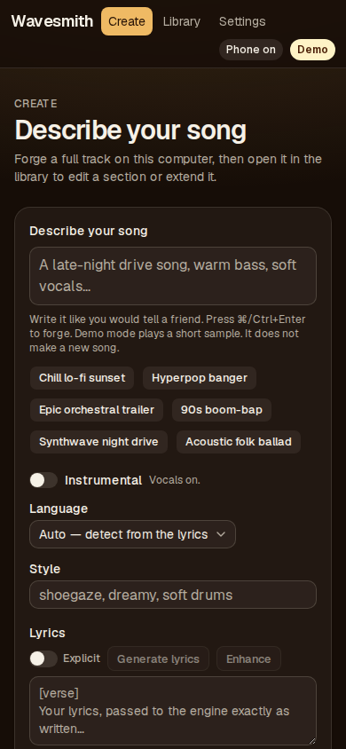</td>
  </tr>
  <tr>
    <td>Before pairing</td>
    <td>After pairing</td>
  </tr>
</table>

### Languages & lyrics

ACE-Step supports **50+ vocal languages** (one language code per forge). Wavesmith helps get lyrics to the engine correctly:

| Workflow | What happens |
|----------|----------------|
| **Simple tab** (prompt only) | Engine LM writes lyrics from your description (English by default unless the prompt strongly implies another language). |
| **Advanced tab** (lyrics field) | Your lyrics pass through **verbatim** — best for custom text, explicit content, or a chosen language. |
| **Lyrics embedded in the prompt** | If you paste `Verse 1:` / `[chorus]` / `Bridge:` blocks in the prompt with an empty lyrics field, Wavesmith **splits** style from sung text automatically (no Simple Mode rewrite). |
| **Mixed languages** (e.g. English + Russian) | Detected as mixed → engine `unknown` + LM language override disabled. Quality is **best-effort** — true per-section code-switching is not supported by ACE-Step. |
| **API** | `POST /api/generate` accepts optional `vocalLanguage` (`en`, `ru`, `ja`, … or aliases like `Russian`). |

For a fully Russian (or Spanish, Japanese, etc.) vocal, set **Language** on the Create page and put the lyrics in the lyrics box. Auto detects a single script from the lyrics and locks it so the engine planner does not swap the language. Mixed languages stay `unknown`.

Optional **Generate Lyrics** (Ollama) honors a `language` field on `/api/lyrics` for drafting multilingual text before you forge.

**Measured on M2 Max / 32 GB / macOS** (see `docs/ENGINE_NOTES.md`):

- ~22 s per 30 s song when forging 2 variations (batch)
- Stem separation (Demucs, CPU): a few minutes per song
- MIDI transcription (Basic Pitch, CPU): ~10s for short clips; scales with song length

---

## Optional: AI lyric writing (Ollama)

The built-in engine planner can write lyrics in Simple mode. For richer, editable lyrics in Advanced mode:

```bash
brew install ollama
ollama serve          # or launch the Ollama app
ollama pull dolphin3:8b   # ~5 GB; or use a model you already have
```

Set your model in `.env` if needed:

```bash
LYRICS_MODEL=dolphin3:8b
```

Wavesmith applies **no content filtering** to user-supplied lyrics — same as any local DAW.

---

## Optional: Grok hybrid (lyrics and a song plan only)

Audio generation stays on this computer. Grok is off unless you turn it on.

1. Settings → Connection → **Grok hybrid**
2. Provide a key in one of these ways (never commit it):
   - `XAI_API_KEY` in `.env` (gitignored), or
   - paste it into Settings, which writes `data/xai-api-key` (mode `0600`, under the gitignored data directory)
3. Optional: `XAI_MODEL` (default `grok-4`) and `XAI_API_BASE` (default `https://api.x.ai/v1`)

**Write with Grok** asks xAI’s OpenAI-compatible chat endpoint for lyrics in the language you picked, plus a suggested structure, tempo, key, and style tags. Forge still uses ACE-Step locally.

If you are offline, the key is missing, the API errors, or Grok refuses, Wavesmith says so in plain language and uses the local lyrics writer when Ollama is running. Otherwise you write the lyrics yourself.

**Local only** (the default) never calls xAI, even if a key is present.

**Unrestricted lyrics** (Settings → Lyrics) keeps Grok out of the path on purpose: a hosted model may refuse. The local engine and the local lyrics writer still receive your text unchanged. Wavesmith does not add its own content filter.

---

## Editing a song

Open a song from the library.

- **Regenerate a section** — rewrites that time range with the lyrics in the editor and keeps the audio outside it. This is ACE-Step turbo `repaint` (`chunk_mask_mode=explicit`). A new song is saved; the original remains.
- **Extend** — continues the song with the base model’s `complete` task. Pick +15s or +30s and optional new section lyrics. Turbo is unloaded for that job (one model in memory), then loaded again. The first Extend after setup is slower: base uses 50 steps and classifier-free guidance.
- **Time the lyrics** — places each sung line and word on the timeline so Regenerate cuts there. It uses a local Whisper aligner (`stable-ts`) on the vocal stem when you have one, otherwise the full mix. If the aligner is not installed, or the timings no longer match the text, cuts fall back to lyric-tag estimates.

`./scripts/setup.sh` downloads `acestep-v15-base` (~4.7 GB, next to turbo) and creates `.venv-align`. If the base weights are missing, Extend explains how to finish setup and does not start the job. New songs still use turbo.

**If extend does not actually get longer, the job fails** and nothing new is saved. The pinned engine sizes `complete` to the file you upload, so Wavesmith appends the requested silence and asks the base model to complete that tail. A result that is not longer is discarded.

**Not in this pass:** swapping new vocals over an untouched instrumental. Repaint rewrites the whole time range (melody and accompaniment), not the vocal stem alone. ACE-Step’s own lyric timestamps need generation latents that the REST API does not return, so timings come from the local aligner instead.

Demo mode (`MOCK_ENGINE=1`) plays one short sample for every song. The length on screen is that file, not the length you picked. Section edits and Extend do not save a new song, and they say so. Stems are copies of the sample, kept as MP3. The notes file is a bundled sample, labeled as such. Word times are estimates.

---

## Demo mode (no engine, no GPU)

Tour the UI without installing ACE-Step or downloading weights:

```bash
# In .env:
MOCK_ENGINE=1

pnpm install   # if you skipped full setup
pnpm dev --hostname 127.0.0.1 --port 3000
```

Forge completes instantly using the bundled `public/demo-clip.mp3` (about 10 seconds). The library shows that length. A header badge says it is demo mode.

---

## Production run

```bash
wavesmith start
```

Same URLs: the app on **127.0.0.1:3000**, the engine on **127.0.0.1:8001**. `wavesmith update` pulls, installs, migrates, and rebuilds without deleting `data/` or `.env`. `./scripts/start.sh` is the same production bind if you are already in the checkout.

---

## Troubleshooting

### `Request failed (404)` when clicking Forge

The app is not running, or the browser is on the wrong port. Run `wavesmith start` and use **http://127.0.0.1:3000**. `wavesmith doctor` names the fix when a check fails.

### Banner says "Engine offline"

Start both processes with `wavesmith start`, not the engine alone. `wavesmith logs` shows what they printed.

### Banner says "Engine starting…" for a long time

First run downloads and loads several GB of weights — normal once. Subsequent warm-ups are ~45 s.

### Model download stalls

See the direct-download fallback note in `docs/DECISIONS.md`. Re-run `./scripts/setup.sh` after fixing network/disk space.

### Stems button fails

Ensure Demucs installed: `demucs --help`. Re-run setup step or:

```bash
uv tool install --python 3.12 --with "torchaudio<2.9" --with soundfile demucs==4.0.1
```

### MIDI transcription fails

Ensure Basic Pitch is installed: `basic-pitch --help` (first run loads ONNX — can take ~30s). Re-run setup or:

```bash
uv tool install --python 3.12 --with "setuptools<81" --with onnxruntime --with "scipy==1.11.4" "basic-pitch[onnx]"
```

Transcription is **approximate** — monophonic parts work best. Try a **stem** (bass, vocals) instead of the full mix for cleaner results. Runs on CPU only; does not need the ACE-Step engine.

### `pnpm test` / CI

Tests use the mock engine — no GPU or ACE-Step required:

```bash
MOCK_ENGINE=1 pnpm test
MOCK_ENGINE=1 pnpm test:e2e
```

### Real-engine smoke test

With engine running and weights loaded:

```bash
./scripts/smoke.sh
```

---

## Scripts reference

| Script | When to use |
|--------|-------------|
| `scripts/install.sh` | First install on a Mac, or a safe re-run |
| `wavesmith` | Start, stop, update, doctor, logs |
| `scripts/setup.sh` | Download models again without the full installer |
| `scripts/dev.sh` | Daily development (engine + hot-reload app) |
| `scripts/start.sh` | Production-style local run without the `wavesmith` command |
| `scripts/smoke.sh` | Verify full pipeline against real engine |

---

## Configuration

All variables are documented in [`.env.example`](.env.example). Common ones:

| Variable | Default | Notes |
|----------|---------|-------|
| `PORT` | `3000` | App URL port |
| `ENGINE_URL` | `http://127.0.0.1:8001` | ACE-Step REST API |
| `DATA_DIR` | `./data` | Library DB + audio (see layout below) |
| `MOCK_ENGINE` | `0` | Set `1` for demo mode |
| `LYRICS_MODEL` | `dolphin3:8b` | Ollama tag for Generate Lyrics |
| `XAI_API_KEY` | unset | Optional. Grok hybrid only. Prefer this or the Settings key file — never commit it |
| `XAI_MODEL` | `grok-4` | xAI chat model for lyric planning |
| `XAI_API_BASE` | `https://api.x.ai/v1` | OpenAI-compatible chat base URL |

### Where files live (`DATA_DIR`, default `./data`)

| Path | Contents |
|------|----------|
| `data/wavesmith.db` | Library metadata (songs, jobs, stems, MIDI tracks) |
| `data/audio/<song-id>/take.wav` | Master audio (+ cached `take.mp3`) |
| `data/audio/<song-id>/stems/` | Demucs stems (`vocals`, `drums`, `bass`, `other`) |
| `data/audio/<song-id>/midi/` | Basic Pitch MIDI exports (`master`, stem names) |
| `data/xai-api-key` | Optional Grok key, if you saved one in Settings (never commit) |

**Settings → Storage** shows your data and audio directory paths on disk.

---

## Architecture (short)

```
Browser  →  Wavesmith (Next.js @ :3000)  →  ACE-Step REST API (@ :8001)
                ├── SQLite (library, jobs)
                ├── ./data/audio
                ├── Demucs CLI (stems)
                ├── Ollama (optional local lyrics)
                └── xAI Grok (optional; lyrics + plan only, off by default)
```

- One in-process job queue (concurrency 1 toward the engine)
- `EngineClient` + `MockEngineClient` seam — tests never need a GPU
- Audio served with HTTP **Range** support (seeking depends on it)

Deep dives: [`AGENTS.md`](AGENTS.md), [`docs/ENGINE_NOTES.md`](docs/ENGINE_NOTES.md), [`docs/DECISIONS.md`](docs/DECISIONS.md).

---

## Development

```bash
pnpm typecheck
pnpm lint
MOCK_ENGINE=1 pnpm test
MOCK_ENGINE=1 pnpm test:e2e
```

Milestone build spec (historical): [`wavesmith-claude-code-spec.md`](wavesmith-claude-code-spec.md).

---

## Responsible use

Wavesmith wraps open-source models for **local, personal** music creation. You are responsible for how you use generated audio — respect copyright, likeness rights, and platform policies. [ACE-Step](https://github.com/ace-step/ACE-Step-1.5) includes its own responsible-use guidance upstream.

If you distribute modified versions of Wavesmith, the GPL v3 requires you to provide corresponding source and preserve license notices.

---

## Roadmap

Still open: vocal-only swap, engine-native stems, LoRA UI, voice-to-prompt, SSE job updates, Tauri desktop wrap — see spec §14 in `wavesmith-claude-code-spec.md`. Extend uses base `complete` (with a silence-tail upload, because v0.1.8 does not pad that task). Lyric timings are local forced alignment, not ACE-Step LRC.

---

## License

**Wavesmith** is free software licensed under the [GNU General Public License v3.0](LICENSE) (or later, at your option).

Copyright © 2026 Sirius T.Bontea.

**Author:** Sirius T.Bontea

For git commits in this repo, use the author identity documented in `AGENTS.md`. Do not add AI co-author trailers.

### Third-party components

- **[ACE-Step 1.5](https://github.com/ace-step/ACE-Step-1.5)** — music engine (MIT; cloned at setup, not vendored in git). Wavesmith communicates with it as a separate process.
- Other dependencies — see `package.json` and `pnpm-lock.yaml`; each package retains its own license.
